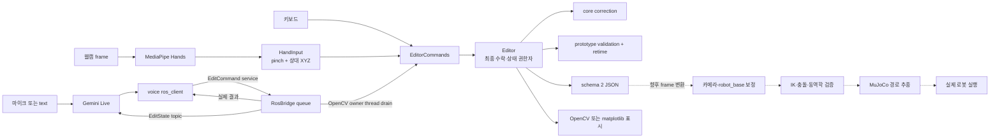

# 26_project_manipulator

음성 명령과 일반 웹캠의 손 입력으로 왕복 3D 경로를 편집하고, 이후 로봇 검증·시뮬레이션·실기 실행까지 연결하기 위한 자작 매니퓰레이터 프로젝트다.

최종 목표 흐름은 다음과 같다.

> 음성으로 수정 의사·대상 전달 → 편집 상태 진입 → 웹캠 손 인식 → 핀치로 경로점 선택 → XYZ 이동 입력 → 경로 수정·제약 적용 → 결과 확인·되돌리기·저장 → 로봇 경로 검증 → 시뮬레이션·실제 로봇 실행

이 전체 흐름이 완성된 상태는 아니다. 현재 코드는 **가상 좌표계의 경로 편집 시연**까지 구현하며 실제 로봇 실행은 차단한다.

## 현재 구현 상태

| 단계/기능 | 관련 파일·모듈 | 구현 여부 | 검증 수준 | 제한사항·남은 작업 |
|---|---|---|---|---|
| 가는 길/오는 길/둘 다 선택 | `editor.py`, `webcam.py` | 구현됨 | 자동 테스트 및 합성 화면 검증 | 실제 음성으로 세 모드 전환은 미확인 |
| 국소 경로 수정·끝점 보호 | `core.py`, `editor.py` | 구현됨 | 회귀 테스트 통과 | 로봇 기구학에 따른 수정 가능 영역은 미연결 |
| 작은 재수정 시 경로가 튀는 오류 수정 | `Correction.profile_residual` | 구현됨 | 8 cm 수정 후 1 µm 입력 재현 검증 | 상세 수치는 [`RESULT.md`](path%20편집/RESULT.md) 참고 |
| 경로 길이 기반 실행 시간 재계산 | `validation.py`, `PathData` | 구현됨 | 길이 증가 및 반복 retime 회귀 테스트 | 시간 계획일 뿐 관절 궤적 검증이 아님 |
| undo/redo/reset/전체 취소 | `editor.py`, `ros_bridge.py` | 구현됨 | 자동 테스트 통과 | 드래그 중 상태 변경은 의도적으로 거부 |
| schema 2 저장·로드·schema 1 migration | `storage.py` | 구현됨 | 원자 저장·strict load 테스트 | `robot_base`와 `virtual_edit_frame` 세션 혼용 금지 |
| matplotlib 마우스 편집기 | `viewer.py` | 구현됨 | headless 렌더링 및 자동 테스트 | 실제 웹캠을 사용하지 않는 기존 검증 UI |
| 웹캠 영상·경로 오버레이 | `webcam.py` | 구현됨 | 실제 `/dev/video0` 1 frame 읽기, 합성 렌더링 | 실제 카메라 창에서 장시간 사용자 조작 미확인 |
| MediaPipe 손·핀치·XYZ 입력 | `webcam.py` | 구현됨 | MediaPipe 실제 frame 처리, 합성 landmark 테스트 | 실제 frame에서 손 검출은 안 됐고 실제 핀치 조작 미확인 |
| 추적 상실 동결·timeout 취소·재시작 조건 | `HandInput` | 구현됨 | 합성 입력 회귀 테스트 | 다양한 조명과 실제 손에서 미확인 |
| Gemini 명령 변환 | 음성 브랜치 `commands.py`, `gemini_live.py` | 구현됨 | fake Live session과 함수 호출 테스트 | 실제 Gemini API·호출어·마이크·스피커 미확인 |
| 음성 명령과 실제 Editor 연결 | `ros_client.py` → `ros_bridge.py` | 구현됨 | ROS 2 Jazzy 실제 service round trip 및 합성 tool call 검증 | 실제 음성부터 화면까지의 장치 통합은 미확인 |
| ROS queue·deadline·중복 request ID | `ros_bridge.py` | 구현됨 | timeout·중복 undo 회귀 테스트 | 단일 프로세스 lifetime cache이며 분산 영속 저장은 아님 |
| OpenCV UI | `webcam.render` | 구현됨 | 합성 screenshot 육안 확인 | 별도의 제품 UI 시안이나 외부 디자인은 이 저장소에 구현돼 있지 않음 |
| 6-DOF URDF/RViz·MuJoCo 모델 | `urdf` 브랜치 `6dof_description/` | 모델 파일 존재 | 해당 브랜치 문서 기준; 이번 문서 작업에서는 실행하지 않음 | 편집 경로와 연결되지 않았고 추종 제어 없음 |
| IK·관절 한계·특이점·충돌·동역학·토크 | `validation.py`의 robot check 항목 | 미구현 | 화면과 저장 결과에 `NOT_EVALUATED` 표시 | 실제 robot model 기반 validator 필요 |
| 시뮬레이션 경로 추종·하드웨어 실행 | 없음 | 미구현 | 미검증 | 현재 `REQUEST_EXECUTION`은 항상 거부 |

2026-09-29의 과거 결과는 경로 110개, 음성 132개 자동 테스트 통과로 [`RESULT.md`](path%20편집/RESULT.md)에 기록돼 있다. 아래 “이번 문서 작업에서 확인한 내용”은 이번에 실제 재실행한 결과만 별도로 적는다. 자동 테스트는 실제 카메라·마이크·로봇 검증을 대신하지 않는다.

## 브랜치와 디렉터리 구조

이 프로젝트의 기능은 아직 한 브랜치에 합쳐져 있지 않다.

| Git 브랜치 | 현재 컴퓨터의 worktree 폴더 | 내용 |
|---|---|---|
| `work/webcam-path-editor` | `~/manipulator_branches/main/` | 이 README와 `path 편집/` |
| `work/gemini-live-voice` | `~/manipulator_branches/voice/` | Gemini Live, ROS 2 interface와 음성 노드 |
| `urdf` | `~/manipulator_branches/urdf/` | `6dof_description` URDF/RViz/MuJoCo 모델 |
| `main` | 현재 작업 폴더가 아님 | 통합 기준 브랜치. 위 작업들이 아직 모두 병합된 상태가 아님 |

`main/`은 로컬 worktree의 폴더 이름일 뿐 현재 체크아웃 브랜치를 보장하지 않는다. 실제 브랜치는 `git branch --show-current`로 확인한다. 현재 `~/manipulator_branches/main`은 `work/webcam-path-editor`다.

현재 컴퓨터의 핵심 구조:

```text
~/manipulator_branches/                 # Git 저장소 자체가 아닌 worktree 모음
├── main/                               # work/webcam-path-editor
│   ├── README.md
│   └── path 편집/
│       ├── configs/demo.json
│       ├── src/pac_path_editor/
│       └── tests/
├── voice/                              # work/gemini-live-voice
│   ├── requirements-voice.txt
│   └── src/{manipulator_interfaces,manipulator_voice}/
├── urdf/                               # urdf
│   └── 6dof_description/
└── .venv-webcam/                       # 로컬 가상환경, Git 비관리
```

GitHub에서 새로 clone하면 처음부터 `main/`, `voice/`, `urdf/` 세 폴더가 생기지 않는다. 다음 절차가 현재 통합 개발 구조를 재현한다.

```bash
mkdir -p ~/manipulator_branches
cd ~/manipulator_branches
git clone https://github.com/jaemin0319/26_project_manipulator.git main
cd main
git switch --track origin/work/webcam-path-editor
git branch --track work/gemini-live-voice origin/work/gemini-live-voice
git branch --track urdf origin/urdf
git worktree add ../voice work/gemini-live-voice
git worktree add ../urdf urdf
cd ..
git -C main worktree list
git -C main branch --show-current
```

이미 같은 이름의 로컬 브랜치가 있으면 `git branch --track ...`를 다시 실행하지 말고 `git branch -vv`로 위치를 확인한다. 브랜치 전환 전에 항상 변경사항을 확인한다.

세부 문서:

- [경로 편집기 README](path%20편집/README.md)
- [경로 편집 설계](path%20편집/DESIGN.md)
- [검증 수치와 장치 확인 범위](path%20편집/RESULT.md)
- [음성 브랜치 README](https://github.com/jaemin0319/26_project_manipulator/blob/work/gemini-live-voice/README.md)
- [URDF 브랜치 README](https://github.com/jaemin0319/26_project_manipulator/blob/urdf/6dof_description/README.md)

## 모듈과 데이터 흐름

### 핵심 모듈

| 모듈 | 입력 | 출력·책임 |
|---|---|---|
| `core.py` | 원본 `PathData`, correction, drag delta, `Config` | 왕복 경로 생성, 국소 correction field, 끝점 보호, 변위 제한, 보간 |
| `editor.py` | 시작/모드/drag/undo/redo/reset/finish 명령 | 편집 transaction, preview, history, revision, 현재·확정 경로 |
| `validation.py` | 원본·후보 경로와 timing reference | 기하 검사, 길이·속도 기반 실행 시간, 균일 시간 재샘플링, robot check `NOT_EVALUATED` |
| `storage.py` | 검사를 통과한 session | schema 2 JSON 원자 저장, strict load, schema 1 명시적 migration |
| `viewer.py` | 마우스와 matplotlib 이벤트 | 기존 camera-plane 편집 UI, screenshot, 저장 |
| `webcam.py` | OpenCV frame, MediaPipe landmark 21개, 키 입력 | mirror, 손 커서·pinch 상태, 상대 XYZ 변환, 경로 선택, OpenCV overlay |
| `ros_bridge.py` | ROS `EditCommand` request 또는 키보드 command | deadline/idempotency queue, owner thread의 Editor 호출, 실제 결과 service 응답과 state publish |
| 음성 `commands.py` | Gemini function call 이름과 인자 | enum 검증 후 ROS event/mode 변환 |
| 음성 `gemini_live.py` | 마이크 또는 text, Gemini Live response | 호출어 처리, function call 실행, 실제 service 결과 이후 안내 |
| 음성 `ros_client.py` | 변환된 음성 command | `/manipulator/edit_command` 요청과 `/manipulator/edit_state` 구독 |
| `EditCommand.srv` | command, mode, source, request ID, deadline | accepted, state, mode, revision, validation, reason, 처리 시각 |
| `EditState.msg` | Editor의 최신 결과 | 표시용 state topic. 명령으로 재실행하지 않음 |

현재 연결과 향후 연결:



통합 모드의 최종 상태와 수락 여부는 음성 상태기계가 아니라 웹캠 프로세스의 **실제 `Editor`**가 결정한다. `ros_bridge.py`가 그 결과를 service 응답으로 돌려준다. 음성 브랜치의 `edit_state_node`는 Editor가 없는 독립 음성 시험용 시뮬레이터이므로 통합 실행과 동시에 띄우지 않는다.

`urdf` 브랜치의 `6dof_description/`에는 `urdf/6dof.xacro`, STL mesh, RViz 설정, `launch/display.launch.py`, MuJoCo XML이 있다. 이 패키지는 모델 표시와 수동 관절 조작용이며 현재 경로 편집기의 `PathData`를 받거나 추종하지 않는다. 따라서 모델 파일의 존재를 IK·충돌 검사 또는 시뮬레이션 경로 실행이 구현됐다는 뜻으로 해석하면 안 된다.

## Ubuntu 24.04 설치

### 확인 환경과 지원 범위

- 코드 선언: Python `>=3.10`
- 실제 확인 환경: Ubuntu 24.04.4 LTS, Python 3.12.3
- 실제 확인 패키지: NumPy 1.26.4, matplotlib 3.6.3, MediaPipe 0.10.21, OpenCV 4.11.0
- ROS 통합 확인 환경: ROS 2 Jazzy

Python 3.10 이상이라는 선언은 모든 조합의 장치 검증을 뜻하지 않는다. 현재 재현성이 확인된 조합은 Ubuntu 24.04/Python 3.12.3이다.

### 시스템 패키지

기본 개발 환경:

```bash
sudo apt update
sudo apt install -y git curl python3-venv python3-pip
```

OpenCV wheel import에서 공유 라이브러리 오류가 날 때만 Ubuntu 24.04의 GUI runtime을 확인한다.

```bash
sudo apt install -y libgl1 libglib2.0-0t64
```

음성에서 실제 마이크·스피커를 쓸 때 PortAudio runtime이 필요하다.

```bash
sudo apt install -y libportaudio2
```

ROS 통합은 Ubuntu 24.04용 ROS 2 Jazzy가 필요하다. [ROS 2 Jazzy 공식 Ubuntu deb 설치 문서](https://docs.ros.org/en/jazzy/Installation/Ubuntu-Install-Debs.html)를 따라 설치하고, 개발 도구와 desktop 설치를 선택한 경우 다음 파일이 있어야 한다.

```bash
test -f /opt/ros/jazzy/setup.bash && echo "ROS 2 Jazzy 설치 확인"
```

시스템 Python에 `sudo pip install`을 실행하지 않는다.

### Python 가상환경과 프로젝트 설치

아래 명령은 위의 세 worktree 구조를 만든 뒤 `~/manipulator_branches`에서 실행한다. `--system-site-packages`는 apt로 설치된 ROS Python 패키지를 같은 Python 3.12 가상환경에서 사용하기 위해 실제 확인 환경에서 사용한 방식이다.

```bash
cd ~/manipulator_branches
python3 -m venv --system-site-packages .venv-webcam
source .venv-webcam/bin/activate
python -m pip install --upgrade pip
python -m pip install -e "./main/path 편집[webcam,dev]"
python -m pip install -r voice/requirements-voice.txt
python -m pip check
```

웹캠만 사용할 때는 마지막 `requirements-voice.txt` 설치가 필요 없다. 다른 프로젝트의 가상환경을 재사용하거나 변경하지 않는다.

직접 의존성:

| 설치 위치 | 의존성 | 코드의 버전 조건 | 목적 |
|---|---|---|---|
| 기본 | `numpy` | `>=1.26,<2` | 경로·벡터·보간 계산, ROS 음성 환경의 NumPy 2 비호환 방지 |
| 기본 | `matplotlib` | `>=3.6` | 기존 마우스 viewer와 headless screenshot |
| `webcam` extra | `mediapipe` | `==0.10.21` | 한 손 landmark 추적 |
| `webcam` extra | `opencv-contrib-python` | `==4.11.0.86` | 카메라, 영상 변환, GUI·overlay |
| `dev` extra | `pytest` | `>=7.4` | 경로 편집기 자동 테스트 |
| 음성 requirements | `google-genai` | `>=2.25,<3` | Gemini Live 연결 |
| 음성 requirements | `sounddevice` | `>=0.5` | PortAudio 마이크·스피커 |
| 음성 requirements | `soxr` | `>=0.5` | 오디오 sample rate 변환 |
| 음성 requirements | `python-dotenv` | `>=1.0` | `.env` 로드 |
| 음성 requirements | `numpy` | `<2` | ROS Jazzy 환경과의 호환성 |
| apt/ROS | `rclpy`, `colcon`, rosidl 도구 | ROS 2 Jazzy | ROS service/message build와 실행 |

`opencv-python`, `opencv-python-headless`, `opencv-contrib-python`을 함께 설치하지 않는다. 이 프로젝트는 GUI가 포함된 `opencv-contrib-python` 하나를 사용한다.

### MediaPipe 모델

고정된 MediaPipe 0.10.21에서는 `mp.solutions.hands`가 확인돼 별도 모델 파일이 필요 없다. `hand_api=tasks`를 명시하거나 향후 설치본에서 Solutions API를 사용할 수 없을 때만 Hand Landmarker 모델을 배치한다.

```bash
cd ~/manipulator_branches/main/'path 편집'
mkdir -p models
curl -L \
  https://storage.googleapis.com/mediapipe-models/hand_landmarker/hand_landmarker/float16/1/hand_landmarker.task \
  -o models/hand_landmarker.task
```

웹캠 설정 JSON에서 `"hand_api": "tasks"`, `"model_path": "models/hand_landmarker.task"`를 설정한다.

### 음성 환경변수

```bash
cd ~/manipulator_branches
cp voice/.env.example voice/.env
chmod 600 voice/.env
```

`voice/.env`에는 실제 비밀값을 넣되 커밋하지 않는다.

```dotenv
GEMINI_API_KEY=YOUR_GEMINI_API_KEY
GEMINI_LIVE_MODEL=gemini-3.8-live
GEMINI_TOOL_BEHAVIOR=BLOCKING
GEMINI_VOICE=
VOICE_LOG_DIR=
```

| 변수 | 필수 여부 | 의미 |
|---|---|---|
| `GEMINI_API_KEY` | 음성·text Gemini 연결에 필수 | Gemini API 인증. 로그나 문서에 값 출력 금지 |
| `GEMINI_LIVE_MODEL` | 선택 | 비우면 코드 기본값 `gemini-3.8-live`; 실제 계정에서의 사용 가능 여부는 실행 시 확인 |
| `GEMINI_TOOL_BEHAVIOR` | 선택 | `BLOCKING`, `NON_BLOCKING`, 빈 값. 기본은 결과 대기형 `BLOCKING` |
| `GEMINI_VOICE` | 선택 | 응답 음성 이름 |
| `VOICE_LOG_DIR` | 선택 | 기본 `~/.ros/manipulator_voice`; JSONL 로그 위치 |

API key는 경로 session JSON에 저장되지 않는다.

## 실행 방법

모든 경로 편집 명령은 공백이 있는 `path 편집` 폴더에서 실행하므로 경로를 인용한다.

### A. 웹캠 단독 실행

```bash
cd ~/manipulator_branches/main/'path 편집'
source ../../.venv-webcam/bin/activate
python -m pac_path_editor --webcam --camera 0 --no-voice
```

`--camera 0`은 기본 카메라다. 다른 장치는 `--camera 1`처럼 바꾼다. 정상 실행하면 실제 카메라 배경, outbound 실선, return 점선, 방향 화살표, 상태·mode·pinch·hand 표시, Z color bar가 나타난다.

장치 없이 연결을 확인하려면:

```bash
python -m pac_path_editor --webcam --synthetic --no-voice \
  --screenshot output/synthetic.png --save output/synthetic.json
```

웹캠 CLI 옵션:

```text
--camera INDEX             카메라 번호
--webcam-config FILE       WebcamConfig JSON
--config FILE              core Config JSON
--load SESSION.json        schema 2 virtual_edit_frame session 로드
--save SESSION.json        저장 경로, 기본 output/webcam-session.json
--synthetic                카메라 없이 합성 입력 실행
--screenshot IMAGE.png     합성 모드 screenshot
--no-voice                 ROS 없이 실행
--ros                      ROS bridge 포함 실행
```

### B. 기존 마우스 기반 viewer

```bash
cd ~/manipulator_branches/main/'path 편집'
source ../../.venv-webcam/bin/activate
python -m pac_path_editor --config configs/demo.json
```

headless 확인:

```bash
python -m pac_path_editor --config configs/demo.json --demo bump \
  --headless --screenshot output/bump.png
```

이 viewer는 실제 웹캠이나 MediaPipe를 쓰지 않고 matplotlib camera projection과 마우스로 같은 `Editor/core`를 검사한다. 기본 저장 경로는 `output/session.json`이고 `robot_base` frame을 사용한다. 웹캠 session의 `virtual_edit_frame`과 서로 바꿔 읽지 않는다.

### C. ROS 연결 실행

음성 worktree에는 별도 통합 launch 파일이 없다. interface 변경 뒤에는 직접 build하고 각 터미널에서 setup 파일을 순서대로 source한다.

빌드:

```bash
cd ~/manipulator_branches/voice
source /opt/ros/jazzy/setup.bash
source ../.venv-webcam/bin/activate
python -m colcon build --symlink-install \
  --packages-select manipulator_interfaces manipulator_voice
source install/setup.bash
ros2 interface show manipulator_interfaces/srv/EditCommand
```

터미널 1, 실제 Editor와 유일한 service server:

```bash
cd ~/manipulator_branches/main/'path 편집'
source /opt/ros/jazzy/setup.bash
source ../../.venv-webcam/bin/activate
source ../../voice/install/setup.bash
python -m pac_path_editor --webcam --camera 0 --ros
```

상태 확인용 터미널:

```bash
source /opt/ros/jazzy/setup.bash
source ~/manipulator_branches/voice/install/setup.bash
ros2 topic echo /manipulator/edit_state
ros2 service type /manipulator/edit_command
```

`ros2 run manipulator_voice edit_state_node`는 음성 단독 시험용 상태 시뮬레이터다. 웹캠 `--ros`와 함께 실행하면 `/manipulator/edit_command` 서버가 중복되므로 실행하지 않는다.

코드상 Jazzy interface, service, topic을 지원하고 이 컴퓨터에서 build와 실제 local service round trip이 확인됐다. 새 컴퓨터의 카메라·DDS·방화벽·ROS domain 조합은 별도로 확인해야 한다.

### D. 음성 연결 실행

터미널 1에서 위 웹캠 `--ros`를 먼저 실행한 뒤 터미널 2에서:

```bash
cd ~/manipulator_branches
source /opt/ros/jazzy/setup.bash
source .venv-webcam/bin/activate
source voice/install/setup.bash
ros2 run manipulator_voice voice_commander \
  --env-file voice/.env --no-speaker
```

기본 호출어는 “자비스”다. 예:

- “자비스, 가는 길 수정” → `outbound`
- “자비스, 오는 길 수정” → `return`
- “자비스, 둘 다 수정” → `both`
- “자비스, 되돌려” / “다시 적용” / “처음으로” / “수정 취소”

Gemini는 function call을 ROS service로 보낸 뒤 실제 Editor의 accepted/state/mode/revision/validation/reason을 받고 안내한다. 실패나 timeout을 성공으로 안내하지 않도록 구현돼 있다.

장치·입력 확인 옵션:

```bash
ros2 run manipulator_voice voice_commander --list-mics
ros2 run manipulator_voice voice_commander --mic-test --mic 0
ros2 run manipulator_voice voice_commander --env-file voice/.env --text --no-speaker
```

`--text`도 Gemini API와 ROS service를 사용한다. 이번 구현 후 실제 마이크·Gemini·스피커의 통합 실행은 아직 확인되지 않았다.

## 웹캠 조작

OpenCV 창에 키보드 포커스가 있어야 단축키가 들어간다.

| 키/입력 | 실제 동작 |
|---|---|
| `E` | 현재 확정 경로에서 편집 session 시작 |
| `1` | `both` 선택. 대기 중이면 편집도 시작 |
| `2` | `outbound` 선택. 대기 중이면 편집도 시작 |
| `3` | `return` 선택. 대기 중이면 편집도 시작 |
| `U` | 마지막 완료 gesture/reset undo |
| `Y` | redo |
| `R` | 현재 편집 후보를 원본으로 reset |
| `C` | 편집 session 전체 취소, 확정 경로로 복귀 |
| `F` | 편집 완료 검사. 통과하면 `--save` 경로에 저장 |
| `Esc` | 현재 drag만 취소 |
| `Q` | 종료. 진행 중 drag는 취소되며 자동 저장하지 않음 |

처음 조작하는 순서:

1. `E`, `1`, `2`, `3` 중 하나로 편집을 시작하고 대상을 고른다.
2. 손 전체가 보이게 한 뒤 엄지와 검지를 펼친다. 편집 진입 시 이미 닫힌 손은 먼저 펼쳐야 한다.
3. 엄지 끝 4번과 검지 끝 8번의 중간 커서를 대상 경로 가까이 옮긴다.
4. 경로 위에서 **새로** 핀치한다. 이미 핀치한 채 경로로 접근하면 선택되지 않는다.
5. 핀치를 유지한 채 손 landmark XYZ를 움직여 preview를 확인한다.
6. 손가락을 정상적으로 펼쳐 gesture를 확정한다.
7. 필요하면 `U`, `Y`, `R`로 수정한다.
8. `F`로 검사하고 저장한다.

드래그 중 대상 전환, undo, redo, reset, finish는 거부된다. `Esc` 또는 정상 해제로 drag를 먼저 끝낸다. 손 추적 상실은 정상 pinch 해제로 처리되지 않는다. 짧은 상실은 마지막 preview를 유지하고, `loss_timeout_s`를 넘으면 drag를 취소한다. 재인식만으로 재개하지 않으며 다시 손을 펼친 뒤 새 핀치가 필요하다.

## 좌표계와 Z 입력 제한

- 웹캠 편집 frame은 `virtual_edit_frame`이다. `robot_base`와 같지 않다.
- 영상 overlay는 카메라와 로봇이 정합된 AR이 아니다.
- MediaPipe landmark Z는 카메라에서 손 전체까지의 절대 거리가 아니다. 손목 기준 상대 깊이이므로 손 전체를 앞뒤로 평행 이동해도 기대한 Z 입력이 나오지 않을 수 있다.
- `gain_z`를 키우면 관측된 landmark Z 변화가 확대될 뿐 위 의미 문제가 해결되지는 않는다.
- 현재 `OverlayProjection.project()`는 `points[..., :2]`만 사용한다. 따라서 Z는 선의 **화면 위치나 높이**를 움직이지 않고 고정 color map의 색상, `landmark XYZ`, drag 상세의 요청/applied XYZ와 Z 숫자에 반영된다.
- X/Y 요청과 실제 적용 차이는 파란 요청 화살표, 주황 적용 화살표와 연결선으로 확인한다. Z-only 차이는 정사영에서 두 화살표 위치가 겹칠 수 있으므로 화면의 `request XYZ`, `applied`, `Z` 수치와 색상을 확인한다.
- drag vector norm `drag_limit`, 누적 `total_offset_limit`, 끝점 보호 때문에 요청 XYZ와 실제 적용 XYZ가 다를 수 있다.
- 실제 손 전체 깊이를 안정적으로 얻는 방법은 아직 미해결이다. depth camera 또는 별도 추정·보정 계층이 필요하다.

## 설정

### WebcamConfig (`--webcam-config`)

JSON은 아래 키의 일부만 넣을 수 있으며 알 수 없는 키는 오류다. `--camera`가 있으면 JSON의 `camera`를 덮어쓴다.

| 키 | 기본값 | 단위·의미 | 변경 효과 |
|---|---:|---|---|
| `camera` | `0` | OpenCV device index | 입력 카메라 선택 |
| `width`, `height` | `1280`, `720` | pixel | 요청 capture 및 합성 화면 크기 |
| `mirror` | `true` | boolean | tracker와 표시가 공유하는 frame을 한 번 좌우 반전 |
| `start_x`, `end_x` | `0.15`, `0.85` | 화면 폭 비율 | 시작·목표 X 위치 |
| `path_y` | `0.58` | 화면 높이 비율 | 기준 경로 Y 위치 |
| `virtual_y_span` | `0.48` | virtual frame Y 범위 | virtual Y와 화면 pixel scale |
| `gain_x/y/z` | `0.85/0.48/1.0` | landmark 차이→virtual 변위 배율 | 각 축 입력 크기 |
| `sign_x/y/z` | `+1/-1/-1` | `-1` 또는 `+1` | 각 축 방향 반전 |
| `pinch_close` | `0.28` | 손 크기로 정규화한 거리 | 이 값 이하가 안정되면 pinch 시작 |
| `pinch_open` | `0.45` | 같은 비율 | 이 값 이상이 안정되면 해제 |
| `debounce_s` | `0.08` | s | close/open 상태 지속 시간 |
| `filter_tau_s` | `0.05` | s | landmark 저역 통과 filter 시정수, `0`이면 즉시 반영 |
| `loss_timeout_s` | `0.5` | s | 추적 상실 후 drag 취소 시간 |
| `hand_api` | `auto` | `auto/solutions/tasks` | MediaPipe API 선택 |
| `model_path` | `models/hand_landmarker.task` | 파일 경로 | Tasks API 모델 |
| `confidence` | `0.5` | 0~1 | 손 검출·추적 confidence |

예:

```json
{
  "camera": 1,
  "width": 1280,
  "height": 720,
  "mirror": true,
  "gain_x": 0.85,
  "gain_y": 0.48,
  "gain_z": 1.0,
  "pinch_close": 0.28,
  "pinch_open": 0.45,
  "loss_timeout_s": 0.5
}
```

```bash
python -m pac_path_editor --webcam --no-voice \
  --webcam-config configs/my-webcam.json
```

### 경로·검사 Config (`--config`)

웹캠에서 사용자 Config를 넘길 때 `frame`은 반드시 `virtual_edit_frame`이어야 한다. 저장소의 `configs/demo.json`은 matplotlib용 `robot_base`이므로 웹캠에 그대로 넘기면 의도적으로 거부된다.

| 키 | 기본값 | 단위·의미 | 변경 효과 |
|---|---:|---|---|
| `frame` | core 기본 `robot_base`; 웹캠 생성 시 `virtual_edit_frame` | 좌표 frame label | 저장·load 호환성 결정 |
| `base`, `target` | `[0,0,0.12]`, `[0.6,0,0.12]` | frame length unit | 왕복 경로 끝점 |
| `selection_radius_px` | `18` | pixel | pinch 시작 시 화면 선택 반경 |
| `influence_length` | `0.22` | frame length unit | 국소 correction 폭 |
| `drag_limit` | `0.15` | frame length unit | gesture 하나의 vector norm 상한 |
| `total_offset_limit` | `0.30` | frame length unit | 원본 대비 누적 offset norm 상한 |
| `min_effective_change` | `0.001` | frame length unit | 이보다 작은 완료 gesture 거부 |
| `endpoint_protection` | `0.08` | 원본 path arclength | 끝점 주변 smooth attenuation 길이 |
| `gate.mode` | `anisotropic` | mode | 기존 correction 흡수 gate 방식 |
| `gate.radius` | `0.18` | frame length unit | isotropic gate radius |
| `gate.radius_xy/z` | `0.22/0.16` | frame length unit | anisotropic XY/Z radius |
| `gate.alpha` | `0.5` | 무차원 | gate soft 영역 비율 |
| `initial_duration` | `3.0` | s | 원본 기준시간 `T0` |
| `sample_dt` | `0.03` | s | 실행 sample 간격과 duration 올림 단위 |
| `max_ee_speed` | `0.35` | frame length/s | min-jerk EE 속도 상한 |
| `speed_safety` | `1.01` | 배율 | 속도 시간 여유 |
| `never_shorten` | `true` | boolean | 원본 시간보다 짧아지지 않고 길이 증가를 반영 |
| `colors.z_min/max` | `-0.15/0.65` | frame Z | 고정 Z color 범위 |
| `colors.cmap` | `viridis` | matplotlib colormap | 경로 높이 색상 |

실행 시간은 `never_shorten=true`일 때 원본 `L0/T0`를 보존하고 다음 값 중 큰 값을 `sample_dt` 배수로 올린다.

```text
T_length = T0 × max(1, L/L0)
T_speed  = 1.875 × L × speed_safety / max_ee_speed
```

### 저장 데이터

- 웹캠 기본 저장: 작업 디렉터리 기준 `output/webcam-session.json`
- matplotlib 기본 저장: `output/session.json`
- 저장 시점: `F`/`FINISH_EDIT` 검사 통과 뒤. `Q`는 자동 저장하지 않음
- schema: `2`
- 웹캠 frame: `virtual_edit_frame`
- matplotlib `configs/demo.json` frame: `robot_base`
- session 내용: config, 원본 경로, correction records, validation report, revision, 단위
- 포함하지 않는 값: Gemini API key와 음성 환경변수

로드:

```bash
python -m pac_path_editor --webcam --no-voice --load output/webcam-session.json
python -m pac_path_editor --load output/session.json
```

schema 1은 자동으로 해석하지 않는다. 기존 `robot_base` schema 1만 명시적으로 migration한다.

```bash
python -c 'from pac_path_editor.storage import migrate_v1_session; migrate_v1_session("old.json", "schema2.json")'
```

## 테스트

경로·웹캠 자동 테스트:

```bash
cd ~/manipulator_branches/main/'path 편집'
source ../../.venv-webcam/bin/activate
python -m pytest -q
```

음성 자동 테스트:

```bash
cd ~/manipulator_branches/voice
source /opt/ros/jazzy/setup.bash
source ../.venv-webcam/bin/activate
source install/setup.bash
PYTHONPATH="src/manipulator_voice:$PYTHONPATH" \
  python -m pytest -q src/manipulator_voice/test
```

import와 CLI 확인:

```bash
cd ~/manipulator_branches/main/'path 편집'
../../.venv-webcam/bin/python -c \
  'import cv2, mediapipe, numpy, pac_path_editor; print(cv2.__version__, mediapipe.__version__, numpy.__version__)'
../../.venv-webcam/bin/python -m pac_path_editor --help
../../.venv-webcam/bin/python -m pac_path_editor --webcam --help
```

자동 테스트는 geometry transaction과 합성 hand/audio/ROS 흐름을 확인한다. 실제 손 검출, 마이크 품질, Gemini 계정·모델, DDS 네트워크, robot dynamics를 확인하지 않는다.

### 이번 문서 작업에서 재실행한 검증

2026-10-01에 문서와 실제 코드의 옵션·import를 대조한 뒤 다음을 재실행했다. 이는 2026-09-29 [`RESULT.md`](path%20편집/RESULT.md)에 기록된 과거 실행과 별도다.

| 명령 | 이번 결과 |
|---|---|
| `python -m pytest -q` (`main/path 편집`) | `110 passed in 4.62s` |
| `python -m pytest -q src/manipulator_voice/test` (ROS setup/voice overlay 적용) | `132 passed in 3.58s` |
| `python -c 'import cv2, mediapipe, numpy, pac_path_editor; ...'` | import 성공, OpenCV `4.11.0`, MediaPipe `0.10.21`, NumPy `1.26.4` |
| `python -m pac_path_editor --help` | viewer CLI help 정상 |
| `python -m pac_path_editor --webcam --help` | webcam CLI help 정상 |
| `ros2 run manipulator_voice voice_commander --help` | voice CLI help 정상 |

이번 문서 작업에서는 카메라 frame 취득, 손 검출, 마이크, 스피커, Gemini API, ROS service round trip, RViz, MuJoCo, 실제 로봇을 실행하지 않았다. 그 항목의 상태는 과거 검증 기록과 “미확인” 표기를 유지했다.

## 문제 해결

| 증상 | 가능한 원인 | 확인·조치 |
|---|---|---|
| `No module named mediapipe` | 가상환경 미활성 또는 webcam extra 미설치 | `which python`; `python -m pip show mediapipe`; 가상환경에서 `python -m pip install -e "./main/path 편집[webcam,dev]"` |
| `python3 -m venv` 실패 | Ubuntu venv 패키지 누락 | `python3 --version`; `apt-cache policy python3-venv`; `sudo apt install python3-venv` 후 새 전용 venv 생성 |
| 카메라 열기 실패 | index 오류, 다른 앱 점유, 권한/장치 없음 | `ls -l /dev/video*`; 필요 시 `v4l2-ctl --list-devices`; 다른 앱 종료 후 `--camera 1` 등 확인 |
| OpenCV 창이 뜨지 않음 | 원격/headless session, DISPLAY 없음, headless OpenCV 중복 | `echo "$DISPLAY"`; `python -m pip list | grep -i opencv`; 원격이면 `--synthetic --screenshot ...` 사용. headless와 contrib 동시 설치 금지 |
| 손은 보이는데 경로 선택 안 됨 | 경로 선택 반경 밖, 비대상 mode, close 전이 없음 | 화면 `hand/pinch/armed/mode` 확인; 손을 먼저 펼친 뒤 커서를 대상 선 18 px 안에 두고 새 핀치 |
| 편집 mode인데 drag 안 됨 | 닫힌 손으로 진입, 경로 밖 pinch가 arm 소비, 추적 상실 뒤 재인식 | 손을 충분히 펼쳐 `armed=True`를 확인한 후 다시 접근·핀치 |
| Z 변화가 작거나 선 높이가 안 바뀜 | landmark Z의 상대 깊이 특성, projection이 XY만 사용 | `landmark XYZ`, request/applied, Z 숫자와 색상 확인. 선 위치가 Z로 이동하지 않는 것이 현재 구현. gain만으로 절대 깊이 문제 해결 불가 |
| `manipulator_interfaces` 또는 `rclpy` import 실패 | ROS/overlay source 순서 또는 build 누락 | `source /opt/ros/jazzy/setup.bash`; venv 활성화; `source voice/install/setup.bash`; `ros2 interface show manipulator_interfaces/srv/EditCommand` |
| service 중복·timeout | `edit_state_node`와 webcam bridge 동시 실행, owner loop 정지, 다른 domain | `ros2 node list`; `ros2 service list -t`; 두 터미널의 `echo $ROS_DOMAIN_ID`; 독립 node를 종료하고 webcam `--ros` 하나만 유지 |
| Gemini API 인증 실패 | key 미설정/오류, model 미사용 가능, 네트워크 | `test -n "$GEMINI_API_KEY" && echo set || echo unset`; `.env` 경로와 model 이름 확인. key 값 자체는 출력하지 않음 |
| worktree Git 연결 오류 | `.git`의 gitdir가 이동·삭제됨 | `cat .git`; 원본 clone에서 `git worktree list`; `git worktree repair /새/worktree/경로`. 변경 파일을 지우거나 강제 push하지 않음 |

`v4l2-ctl`이 없다면 진단 목적으로만 `sudo apt install v4l-utils`를 사용할 수 있다.

## 남은 작업

1. 손 전체의 앞뒤 이동을 안정적으로 반영하는 실제 Z/depth 입력을 결정한다.
2. 현재 OpenCV prototype을 실제 사용성 시험하고, 별도 제안 UI가 있다면 코드·상태 모델과 연결해 구현한다.
3. 실제 웹캠 손·핀치, 실제 마이크·호출어·Gemini, ROS bridge를 한 번에 통합 검증한다.
4. `virtual_edit_frame`을 `robot_base`로 변환하는 카메라 보정과 frame 계약을 만든다.
5. 6-DOF 모델을 이용해 IK, 관절 한계, 특이점, 자기충돌, 동역학과 토크를 검증한다.
6. 검증된 경로를 MuJoCo에서 추종하고 오차·시간 계획을 평가한다.
7. 별도 안전 계층과 승인 절차를 거쳐 하드웨어를 연결하고 최종 시연한다.

## 협업 원칙

- `main`은 통합 기준 브랜치이고 기능 작업은 해당 work branch에서 검토한다.
- 웹캠 문서는 `work/webcam-path-editor`, 음성 문서는 `work/gemini-live-voice`, 모델 문서는 `urdf`의 실제 상태를 기준으로 한다.
- 로컬 폴더 `main/`을 보고 Git `main` 브랜치라고 판단하지 않는다.
- 현재 협업에서는 작업물을 `main`에 직접 커밋하거나 push하지 않고 작업 브랜치에서 리뷰 가능한 상태로 남긴다.
- 브랜치 전환·merge 전에 `git status --short --branch`, `git branch -vv`, `git worktree list`로 다른 사람의 변경과 worktree 점유를 확인한다.
- 실제 장치·API를 실행하지 않았다면 자동 테스트 결과를 장치 검증으로 확대해 보고하지 않는다.
