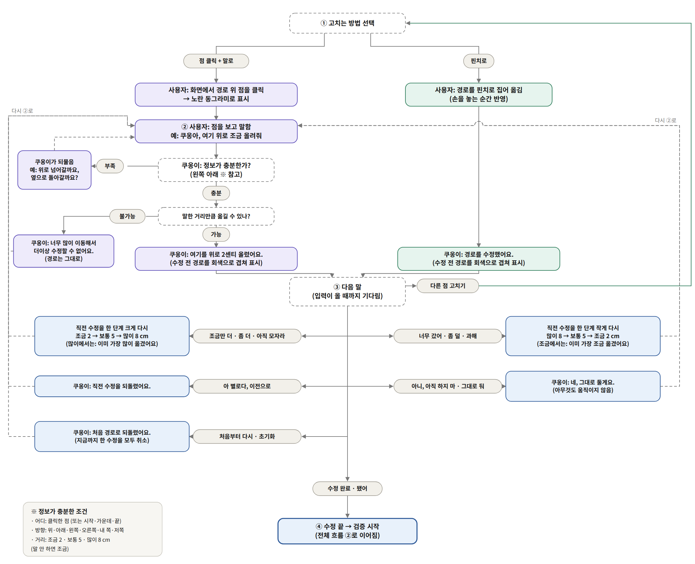

# KHU AI Challenge 2026

말과 손짓으로 로봇팔 경로를 고치는 인터페이스 (ChatKHU 활용)

## 작업 규칙

- main 브랜치에는 직접 올리지 않습니다.
- 각자 자기 브랜치에서 작업하고, 합칠 때는 Pull Request를 올립니다.
- branch 이름은 무엇을 만들었는지 알 수 있는 이름으로 합니다.
- API 키, 개인정보는 절대 올리지 않습니다.

---

# 이 브랜치: `voice-mujoco-path-edit`

MuJoCo 시뮬레이터 화면에 로봇팔의 경로가 그려지고, 사용자는 **화면에서 점을 클릭한 뒤 말로**("쿠옹아, 여기 위로 조금 올려줘") 또는 **마우스로 끌어서** 경로를 고칩니다. 말은 **ChatKHU(경희대 생성형 AI, Gemini Live)** 가 알아듣고, 다 고친 뒤 "수정 완료"라고 하면 시뮬레이터가 경로를 검사(12항목)한 다음 통과할 때만 로봇이 움직입니다.

- 실제 로봇은 움직이지 않습니다. 모든 동작은 MuJoCo 시뮬레이터 안에서만 일어납니다.
- AI 이름은 **쿠옹이**이고, **"쿠옹아"** 라고 부릅니다.
- 조금 · 보통 · 많이는 항상 **2 · 5 · 8 cm** 입니다.

## 한눈에 보기: 대화 흐름

처음 보는 분은 아래 두 그림부터 보면 전체가 이해됩니다.

### 1. 전체 흐름

가는 길을 고쳐서 목표까지 가고(1단계), 도착하면 돌아오는 길을 고칠지 그대로 거꾸로 돌아올지 고릅니다(2단계). 움직이는 중에는 언제든 "멈춰"라고 하면 바로 멈추고, 계속 갈지·돌아갈지를 고를 수 있습니다.


### 2. 경로 수정 흐름 (위 그림의 ①)

점을 클릭하고 말로 고치거나, 핀치(지금은 마우스 끌기)로 고칩니다. 고친 뒤에는 "조금만 더", "너무 갔어", "이전으로", "처음부터 다시" 같은 말로 이어서 고치고, "수정 완료"라고 하면 검사로 넘어갑니다.



멈춘 뒤의 흐름만 따로 그린 그림도 있습니다: [docs/flow/flow3_stop.png](docs/flow/flow3_stop.png)

## 폴더 구성

- `voice/` — ChatKHU 음성 프로그램. 마이크(또는 키보드) → ChatKHU Gemini Live → 시뮬레이터에 명령을 보냅니다.
  - `prompts/system_v5.md` — 지금 쓰는 AI 지시문 (v1~v4는 비교용 이전 버전)
  - `tools.py` — AI가 부를 수 있는 함수 12개, `sim_link.py` — 시뮬레이터 연결
  - `config.yaml` — 호출어, 목소리, 조금·보통·많이(2·5·8 cm) 등 설정
- `mujoco_sim/` — MuJoCo 시뮬레이터. 경로 생성, 클릭·끌기 수정, 12항목 검사, 실행, 멈춤·이어가기, 경로 저장.
- `6dof_description/` — 6축 로봇팔 모델(URDF, 메시, MuJoCo 장면)과 그리퍼.
- `path 편집/` — 경로를 부드럽게 휘게 하는 편집 알고리즘. 시뮬레이터가 그대로 가져다 씁니다.
- `docs/flow/` — 위 흐름도 그림과 그 원본(`.dot`, `flow2_edit_svg.py`).

`mujoco_sim/`, `6dof_description/`, `path 편집/` 은 팀 저장소 `26_project_manipulator`의 `work/integration-all` 브랜치에서 가져와, 이 작업(클릭·음성 수정, 두 단계 흐름, 멈춤·이어가기, 경로 저장)을 더한 것입니다.

## 의존성

**운영체제와 하드웨어**

- Ubuntu 24.04, Python 3.12 에서 확인했습니다.
- 화면이 있는 데스크톱(X11 또는 GNOME Wayland)과 OpenGL이 되는 그래픽(NVIDIA 등)이 필요합니다.
- 음성으로 쓰려면 마이크가 필요하고, 스피커는 선택입니다. 키보드 입력(`--text`)으로도 전부 시험할 수 있습니다.
- 인터넷 연결과 **ChatKHU API 키**(`BAZE_API_KEY`)가 필요합니다.

**시스템 패키지**

- `python3-venv`, `python3-pip`
- `libportaudio2` — 마이크·스피커
- `fonts-noto-cjk` — 시뮬레이터 화면의 한글
- `x11-utils`, `x11-xserver-utils` — 창 크기 읽기와 배치 (없어도 실행은 됩니다)

**파이썬 패키지** (가상환경 두 개를 따로 씁니다)

- 시뮬레이터 `mujoco_sim/.venv` — `mujoco_sim/requirements.lock` 에 버전이 고정되어 있습니다. 주요 패키지: mujoco 3.15.0, numpy 1.26.4, scipy 1.17.1, opencv-python 4.11.0.86, pillow 11.3.0, pytest
- 음성 `.venv-voice` — `voice/requirements.txt`: websockets, pyyaml, numpy, sounddevice, soxr (확인한 버전: websockets 17.2, PyYAML 6.0.3, numpy 2.5.3, sounddevice 0.5.6, soxr 1.1.0)

## 설치 (처음 한 번)

```bash
# 1) 시스템 패키지
sudo apt install -y git python3-venv python3-pip libportaudio2 fonts-noto-cjk x11-utils x11-xserver-utils

# 2) 이 브랜치 받기 (비공개 저장소라 GitHub 로그인이 필요합니다: gh auth login)
git clone -b voice-mujoco-path-edit https://github.com/oryise12/CHATKHU.git ~/CHATKHU
cd ~/CHATKHU

# 3) 시뮬레이터 가상환경 + 로봇 장면 만들기 + 테스트
cd mujoco_sim
python3 -m venv .venv
source scripts/env.sh                 # .venv 활성화, ROS 경로 제거
pip install -r requirements.lock
python -m pinch_sim.build_scene       # 로봇 모델에서 시뮬레이터 장면을 만든다
python -m pytest -q                   # 103 passed 가 나오면 정상 (약 2분)
deactivate
cd ..

# 4) 음성 가상환경
python3 -m venv .venv-voice
.venv-voice/bin/pip install -r voice/requirements.txt

# 5) ChatKHU API 키 (저장소에 절대 넣지 않습니다)
echo 'export BAZE_API_KEY=여기에_키' >> ~/.bashrc
source ~/.bashrc
```

## 실행 (터미널 두 개)

```bash
# 터미널 1: 시뮬레이터 (MuJoCo 3D 창 + 오른쪽 아래 클릭 창)
cd ~/CHATKHU/mujoco_sim && source scripts/env.sh
python -m pinch_sim.app --target-r 0.275 --target-deg 10 --voice-gateway
```

터미널 1에 `voice gateway: /run/user/.../pinch_sim/voice.sock` 줄이 뜬 뒤:

```bash
# 터미널 2: ChatKHU 음성
cd ~/CHATKHU
.venv-voice/bin/python -m voice --sim            # 마이크로 말하기
.venv-voice/bin/python -m voice --sim --text     # 키보드로 입력해서 시험
```

자주 쓰는 옵션:

- `.venv-voice/bin/python -m voice --list-mics` — 마이크 목록, 그다음 `--mic 번호`로 고르기
- `--no-speaker` — 쿠옹이 목소리 없이 터미널 글자로만 답 받기
- 시뮬레이터 창의 버튼(S 선택, V 검사, Y 승인, X 멈춤, N 새 목표)과 마우스로도 같은 일을 할 수 있습니다.

## 쓰는 법

1. 오른쪽 아래 창에서 경로 위 점을 한 번 클릭합니다. 노란 동그라미가 생깁니다. (끌면 그 점의 높이를 직접 바꿉니다. 이것이 나중의 핀치 자리입니다.)
2. "쿠옹아" 라고 부릅니다. 화면 아래에 "쿠옹이가 듣고 있어요"가 뜹니다. 부른 뒤 30초 동안은 호출어 없이 말해도 됩니다. "야" 한 마디로 불러도 됩니다.
3. 말로 고칩니다.
   - "여기 위로 조금 올려줘" → 2 cm, "보통", "많이" → 5, 8 cm, "3센티"처럼 숫자도 됩니다 (한 번에 15 cm까지).
   - "조금만 더" / "너무 갔어" → 직전 수정을 한 단계 크게 / 작게 (2 ↔ 5 ↔ 8 cm)
   - "이전으로", "처음부터 다시", "아니, 아직 하지 마"
   - 방향이 없으면 쿠옹이가 "위로 올릴까요, 옆으로 옮길까요?"처럼 되묻습니다. 방향은 화면 기준입니다(오른쪽 = 화면 오른쪽, 저쪽 = 화면 안쪽).
   - 끝점 바로 옆처럼 말한 거리만큼 옮길 수 없는 곳이면 "너무 많이 이동해서 더이상 수정할 수 없어요."라고 하고 경로는 바꾸지 않습니다.
4. "수정 완료" → 검사 → 통과하면 목표까지 이동합니다.
5. 도착하면 "돌아오는 길을 수정할까요, 가던 길 그대로 반대로 돌아갈까요?"에 답합니다.
6. 움직이는 중 언제든 "멈춰" → 바로 멈춥니다. "계속 가" / "돌아가" / "아니"로 이어갑니다.
7. 처음 자리로 돌아와 "새 목표로 다시 해 볼까요?"에 "아니"라고 하면 경로를 `mujoco_sim/saved_paths/`에 저장합니다.

## 확인한 것과 아직 확인하지 못한 것

확인한 것 (2026-10-14, Ubuntu 24.04):

- 시뮬레이터 자동 테스트 103개 통과 (클릭·음성 수정, 두 단계, 멈춤 후 이어가기, 저장 포함)
- 창 없는 시뮬레이터 + 실제 ChatKHU(텍스트 입력)로 위 흐름 전체: 수정 → 검사 → 이동 → 멈춤 → 돌아가기 → 다시 수정 → 도착 → 반대로 돌아오기 → 저장
- 실제 마이크로 호출어 인식("구호나", "95아"처럼 적혀도 인식) — 일부 대화만

아직 확인하지 못한 것:

- 창을 띄운 상태에서 처음부터 끝까지 한 번에 돌린 시연
- 핀치(손) 입력은 아직 없습니다. 지금은 마우스 끌기가 그 자리를 대신합니다.
- 실제 카메라 영상, 실제 로봇

## 문제 해결

- **`시뮬레이터 소켓이 없습니다`** — 터미널 1의 시뮬레이터가 꺼져 있거나 `--voice-gateway` 없이 켜진 경우입니다. 시뮬레이터를 닫고 위 명령으로 다시 켠 뒤 터미널 2를 실행합니다. 시뮬레이터를 두 개 동시에 켜면 소켓이 겹치니 하나만 켭니다.
- **`환경변수 BAZE_API_KEY가 비어 있습니다`** — 설치 5단계를 확인합니다.
- **"쿠옹아"를 못 알아들을 때** — 터미널 2의 `[사용자]` 줄에 어떻게 적혔는지 보고, `voice/config.yaml`의 `wake_aliases`에 그 표기를 더합니다.
- **MuJoCo 3D 창이 다른 창 뒤에 숨거나 배치가 안 될 때** — GNOME Wayland에서는 창 자동 배치가 되지 않습니다. 3D 창을 손으로 옮기면 됩니다. 3D 창이 가려져도 클릭·음성·이동은 멈추지 않습니다.
- **창 없이 시뮬레이터만 확인하고 싶을 때** — `cd mujoco_sim && source scripts/env.sh && python -m pytest -q`
